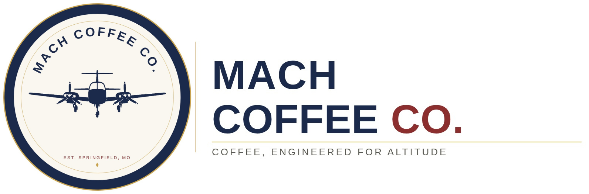

<div align="center">

# Mach Coffee Co.
<div align="center">


Concept website for Mach Coffee Co. — an aviation-themed coffee shop.

**Status:** Concept / pre-launch. Not yet a registered business.

## License

All rights reserved. See `LICENSE` for details. This is a private project —
no permission is granted to use, copy, or distribute any part of this site.

## Development

The site is built with Jekyll. Shared markup lives in `_layouts/default.html`
and `_includes/` (`head`, `header`, `footer`); each page only contains front
matter and its own content.

- **Pages:** all site pages live in `pages/` (each sets a `permalink`).
- **JavaScript:** all scripts live in `assets/js/`. `main.js` (nav, directions
  picker) and `favicon-animation.js` load on every page. Page-specific JS goes
  in `assets/js/<name>.js` and is enabled with `page_js: <name>` in the page's
  front matter.
- **CSS:** page-specific CSS goes in `assets/css/pages/<name>.css` and is
  enabled with `page_css: <name>`.

```bash
bundle install
bundle exec jekyll serve --baseurl ""
```
